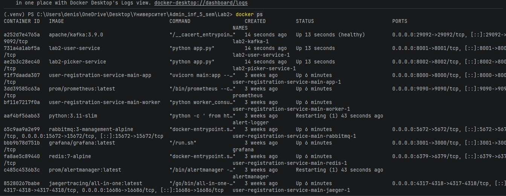
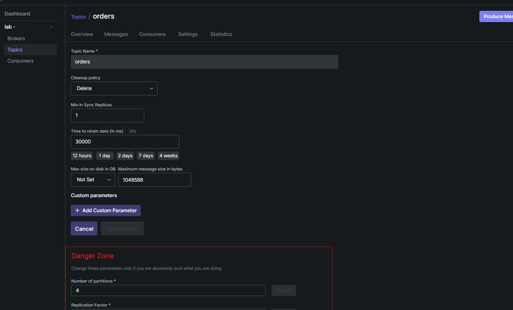
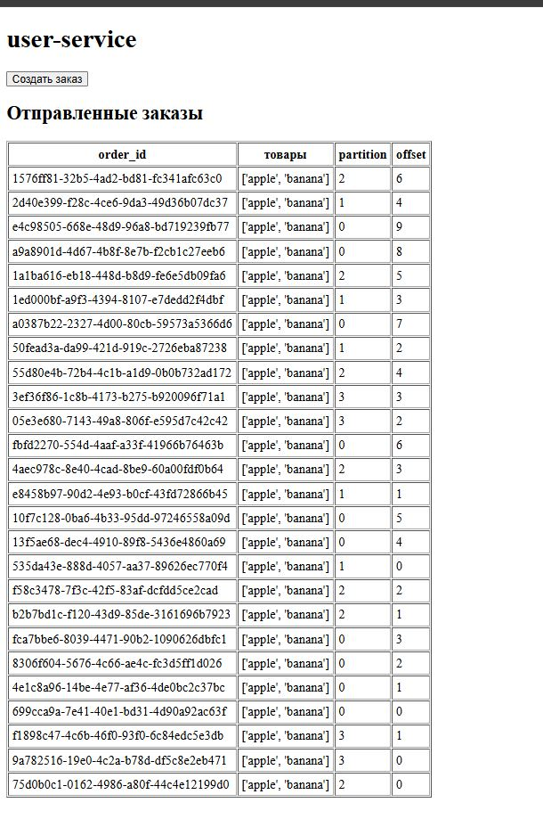
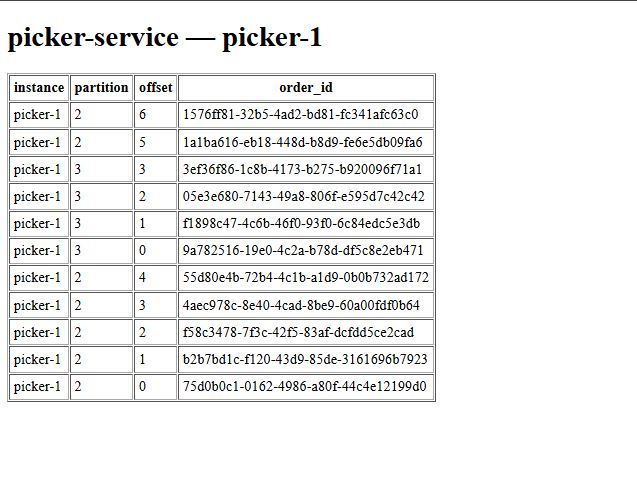
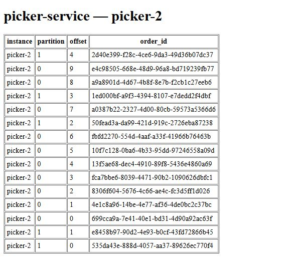
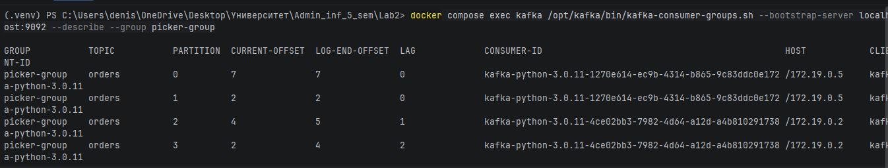
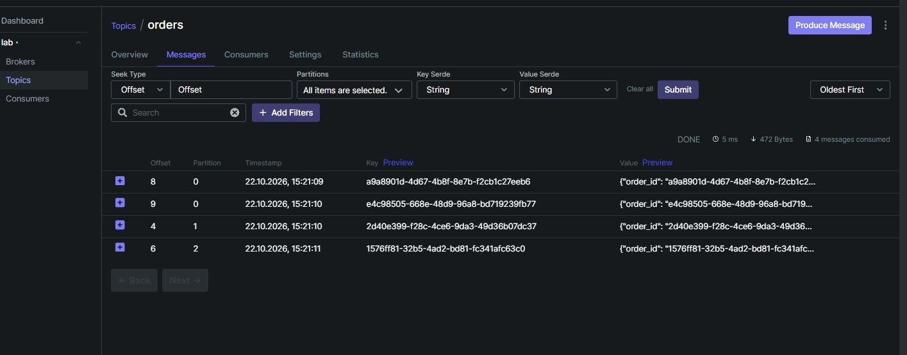
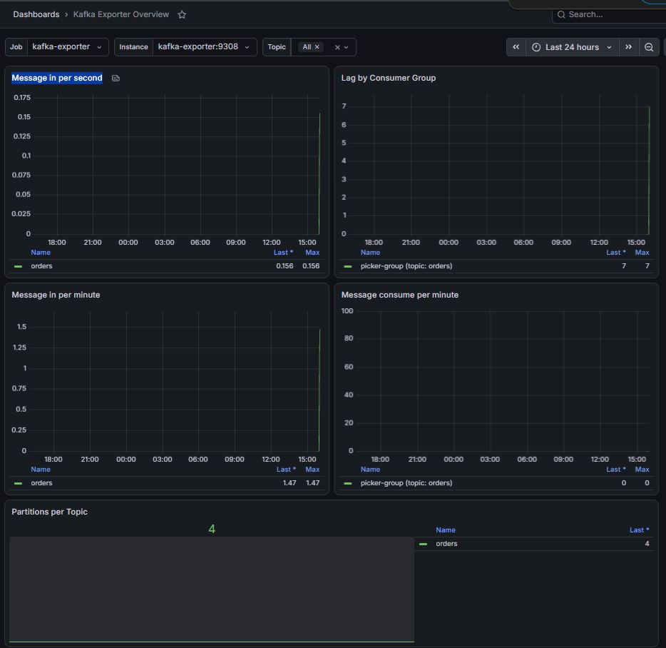

# Работа с Kafka для двух сервисов

## 1. Инфраструктура и сервисы

Для выполнения работы выбран **уровень контейнеров** с использованием **Docker Compose**. Вся инфраструктура описана декларативно в файле `docker-compose.yml`, параметры вынесены в `.env`.

*   **Kafka** запущена в режиме **KRaft** (без ZooKeeper). Для этого в конфигурации заданы роли `broker,controller`, настроены listener'ы для внутренней сети Docker (`kafka:9092`) и для доступа с хоста (`localhost:29092`).
*   **Инициализация топика** (`kafka-init`) полностью автоматизирована через конфигурацию. Используется скрипт, который идемпотентно создает топик (`--create --if-not-exists`), изменяет количество партиций (`--alter`) и применяет настройки хранения (`kafka-configs.sh --add-config`).
*   **user-service** (Python/Flask) — публикует события в Kafka и возвращает `partition` и `offset` при отправке.
*   **picker-service** (Python/Flask) — читает топик группой потребителей.

**Запущенные контейнеры:**

## 2. Бизнес-ситуации (решенные через конфигурацию)

### Ситуация 1: Подготовка к распродаже (Увеличение партиций)
Для подготовки к всплеску заказов и возможности параллельной обработки, количество партиций в топике `orders` было увеличено с 1 до 4. Это было сделано через изменение переменной `KAFKA_TOPIC_PARTITIONS=4` в `.env` и применение конфигурации через `kafka-init` (флаг `--alter`).

**Почему нельзя уменьшить партиции обратно?** 
Kafka использует хэширование ключа сообщения (`order_id`) для определения партиции (`hash(key) % partitions`). Если уменьшить количество партиций, изменится результат хэширования, и Kafka не будет знать, куда девать сообщения из удаляемой партиции. Это нарушит порядок и приведет к потере данных, поэтому уменьшение партиций заблокировано на уровне архитектуры.

**Настройки топика в Kafka UI (retention 30 сек, 4 партиции):**

**Распределение заказов по 4 партициям в user-service:**

### Ситуация 2: Добавление второго сборщика
В `docker-compose.yml` был добавлен второй экземпляр сервиса — `picker-service-2`. Оба сборщика имеют одинаковую переменную `KAFKA_GROUP=picker-group`, поэтому Kafka объединяет их в одну Consumer Group. 
При наличии 4 партиций и 2 сборщиков, Kafka распределяет партиции между ними поровну: `picker-1` забирает партиции 2 и 3, а `picker-2` — 0 и 1. Если бы сборщиков было 5 (больше, чем партиций), пятый экземпляр просто простаивал бы, так как одна партиция может читаться только одним потребителем в группе.

**Работа первого сборщика (picker-1):**

**Работа второго сборщика (picker-2):**

### Ситуация 3: Сборщик упал во время деплоя
При остановке сборщиков и создании новых заказов, сообщения не теряются. Kafka сохраняет их на диск в соответствии с настройками retention. Kafka фиксирует смещение (offset) для каждой группы потребителей в служебном топике. Когда сборщики возвращаются в строй, они продолжают чтение с того offset, на котором остановились. Метрика `LAG` показывает, сколько сообщений накопилось в ожидании.

**Проверка LAG через CLI во время остановки сборщиков:**

## 3. Бизнес-ситуации (решенные через Kafka UI)

### Ситуация 4: Разбор конкретного заказа
В Kafka UI в топике `orders` можно найти конкретное сообщение по ключу (`order_id`), определить его партицию и offset, а затем проверить в разделе Consumers, был ли закоммичен этот offset группой сборщиков.

**Просмотр сообщений в топике:**

### Ситуация 5: Пересчет истории (Сброс offset'ов)
Через Kafka UI был произведен сброс offset'ов (Reset offsets -> earliest). Это возможно только для неактивной группы (статус `Empty` или `Dead`). Kafka позволяет это делать, потому что хранит данные на диске в виде лога, а offset — это лишь «закладка». В классических очередях (RabbitMQ) сообщения удаляются сразу после прочтения, поэтому вернуться назад невозможно.

### Ситуация 6: Диск заполняется (Retention)
Чтобы старые сообщения не занимали место на диске, в `kafka-init` была добавлена настройка `retention.ms=30000` (30 секунд). Kafka удаляет сообщения по истечении этого времени, независимо от того, прочитали их сборщики или нет. Если сборщик упадет на 1 минуту при таком retention, он потеряет заказы, созданные за это время, так как Kafka их уже удалит.

## 4. Мониторинг

Для мониторинга использован стек **Prometheus + Grafana + Kafka Exporter**.
Kafka Exporter необходим, так как Kafka отдает метрики по протоколу JMX, а Prometheus понимает только HTTP. Exporter работает как «переводчик». Prometheus использует Pull-модель (сам опрашивает Exporter раз в 15 секунд).

В качестве дашборда использован популярный шаблон (ID 7589).

**Дашборд Grafana:**

### Выбранные метрики для алертов:

1.  **`kafka_consumergroup_lag` (Отставание потребителей)**
    *   *Что показывает:* Разницу между последним созданным и последним прочитанным сообщением.
    *   *Обоснование:* Если Lag растет, значит сборщики не справляются с нагрузкой (заказы копятся, клиенты ждут). Алерт позволит вовремя добавить партиции или новые экземпляры сборщиков.
2.  **`Message consume per minute` (Скорость чтения)**
    *   *Что показывает:* Количество сообщений, вычитываемых группой в минуту.
    *   *Обоснование:* Падение этой метрики в ноль при растущем Lag означает аварию на стороне потребителей (сборщики зависли, упали или потеряли связь с Kafka).
3.  **`Message in per second` (Скорость создания)**
    *   *Что показывает:* Интенсивность записи сообщений в топик.
    *   *Обоснование:* Резкий скачок метрики может указывать на аномалию — DDoS-атаку на `user-service` или работу ботов-скупщиков. Это позволяет службе безопасности среагировать.