# Лабораторная работа №4 - Репликация базы данных: подними, сломай, восстанови

## Часть 0. Выбор СУБД
Для выполнения лабораторной работы был выбран **PostgreSQL**. 
**Почему:** Мне было интересно поработать с классической реляционной базой, где репликация настраивается вручную через конфигурационные файлы, а failover требует явного вмешательства администратора (в отличие от автоматических выборов в MongoDB). Это дает больше контроля и понимания внутренних процессов.

## Часть 1. Поднятие репликации
Вся инфраструктура поднимается декларативно через `docker compose`. 
1. **Конфигурация Primary:**
   * В `postgresql.conf` установлены: `wal_level = replica`, `max_wal_senders = 10`, `hot_standby = on`, а также `listen_addresses = '*'` (чтобы контейнеры видели друг друга по сети).
   * В `pg_hba.conf` добавлено разрешение на подключение для репликации: `host replication replicator 0.0.0.0/0 scram-sha-256`.
   * Создана роль `replicator` с атрибутом `REPLICATION`.
   
   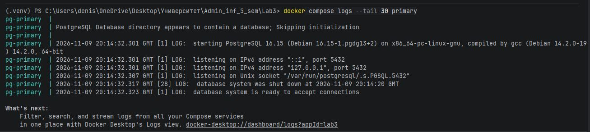
   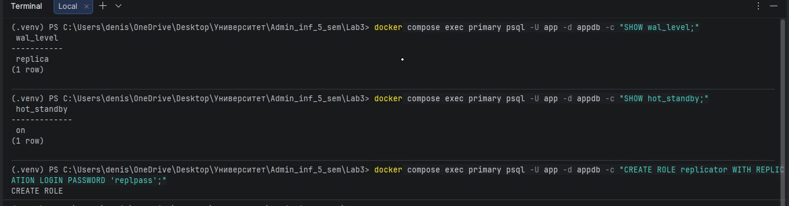

2. **Настройка Standby:**
   * Базовая копия (бэкап) сделана утилитой `pg_basebackup` с флагом `-R` (создает `standby.signal` и настройки подключения).
   * Реплика запущена на порту `5433` (на хосте), чтобы не конфликтовать с primary.
   * Проверено, что данные синхронизируются.
   
   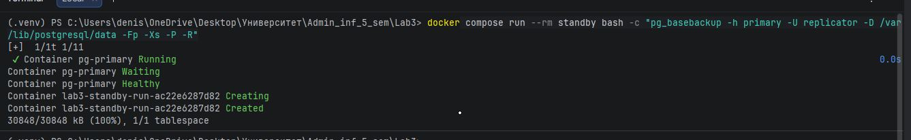
   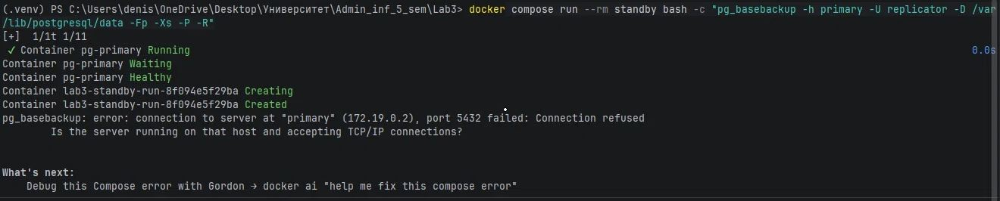

## Часть 2. Подопытный сервис (read/write splitting)
Был использован простой сервис на Python (Flask) с веб-интерфейсом. 
* Запись (кнопки «Создать запись» и «Налить нагрузку») направлена строго в **primary**.
* Чтение (список записей) направлено строго в **standby** (реплику).
* Адреса баз вынесены в переменные окружения в `docker-compose.yml`.

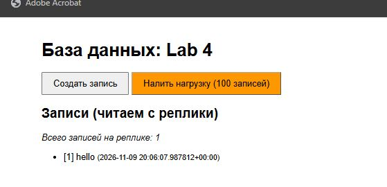

## Часть 3. Replication lag (отставание)
При нажатии кнопки «Налить нагрузку» (100 записей) и последующем обновлении страницы было замечено, что реплика отображает не все данные сразу. Счетчик записей мог показывать меньше, и только потом достигал актуального значения.
* **Почему так происходит:** Репликация настроена асинхронно. Primary записывает данные к себе, отдает WAL-поток реплике и сразу отвечает клиенту «ОК», не дожидаясь, пока реплика применит эти данные. 
* **Чем грозит:** Пользователи могут читать устаревшие данные (eventual consistency), что в некоторых бизнес-сценариях недопустимо.
* **Как измерить:** Отставание измеряется в байтах WAL-журнала. Для этого использовался SQL-запрос к `pg_stat_replication`, который показал лаг в 56 байт.

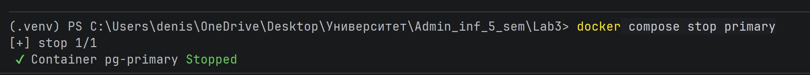
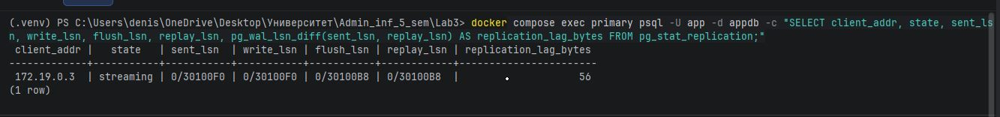
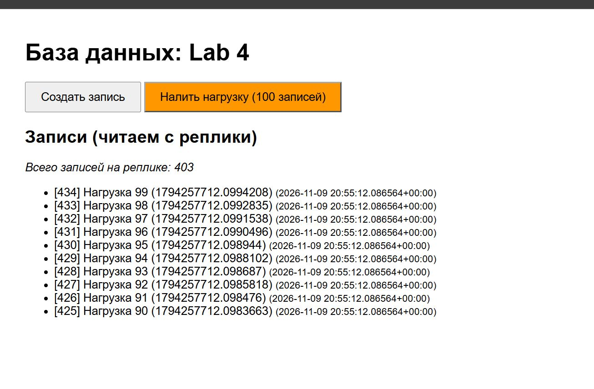

## Часть 4. Теорема CAP
* **К чему тяготеет настройка:** Наша асинхронная репликация тяготеет к **Доступности (A)** и устойчивости к разделению (P). Мы жертвуем **Согласованностью (C)** (разные узлы могут отдавать разные данные в один момент времени) ради того, чтобы primary всегда быстро принимал записи и система не простаивала.
* **Как сместиться в сторону (C) и чем заплатить:** Чтобы реплика всегда отдавала актуальные данные, нужно включить синхронную репликацию (`synchronous_commit = on`). Primary будет ждать подтверждения от реплики. **Цена:** мы заплатим скоростью (latency) - каждая запись будет выполняться дольше, так как зависит от сетевого ответа реплики. Если реплика упадет, primary вообще перестанет принимать запросы на запись.

## Часть 5. Failover (Ручной)
Для проверки отказоустойчивости был остановлен контейнер primary (`docker compose stop primary`).
1. **Что произошло:** Чтение (список записей) продолжало работать, так как оно шло с живой реплики. Попытка создать запись привела к ошибке, так как primary был мертв.
2. **Восстановление:** 
   * На контейнере standby выполнена команда повышения до primary: `pg_ctl promote -D /var/lib/postgresql/data` (с флагом `-u postgres`, так как Postgres не запускается от root).
   * В `docker-compose.yml` сервиса `app` адреса `PRIMARY_HOST` и `REPLICA_HOST` были переключены на контейнер `standby`.
   * Сервис перезапущен, проверка записи прошла успешно (`pg_is_in_recovery = f`).

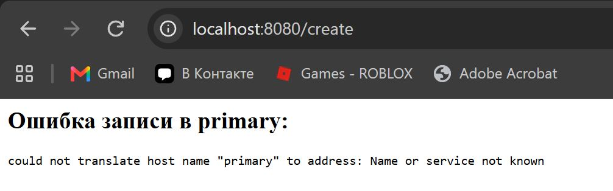
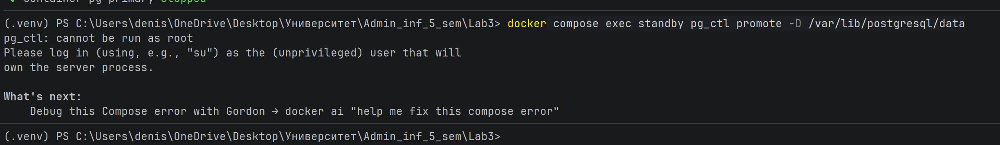
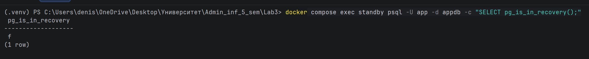
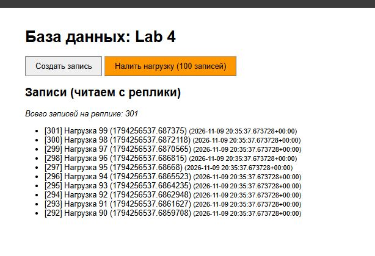

3. **В проде:** Ручной failover занимает много времени (в течение которого запись невозможна). В продакшене используют автоматические менеджеры (например, Patroni), которые замечают падение, сами выбирают новую реплику, повышают её и переключают трафик за секунды.

## Часть 6. Мониторинг
Для мониторинга был поднят стек **Prometheus + Grafana + postgres-exporter**.
Выбраны 3 метрики для алертов:
1. **Активные подключения (`pg_stat_database_numbackends`)**. *Почему:* У Postgres есть лимит подключений. Если приложение «потечет» коннектами, база перестанет пускать новые. Алерт позволит вовремя увеличить лимит или перезапустить сервис.
2. **Откаты транзакций (`rate(pg_stat_database_xact_rollback[5m])`)**. *Почему:* Резкий рост откатов означает дедлоки, ошибки в коде или нехватку ресурсов. Это сигнал, что что-то идет не так на уровне приложения или самой БД.
3. **Отставание репликации (Replication Lag)**. *Почему:* Если реплика отстает слишком сильно, пользователи читают старые данные, а в случае падения primary мы потеряем много данных при failover.

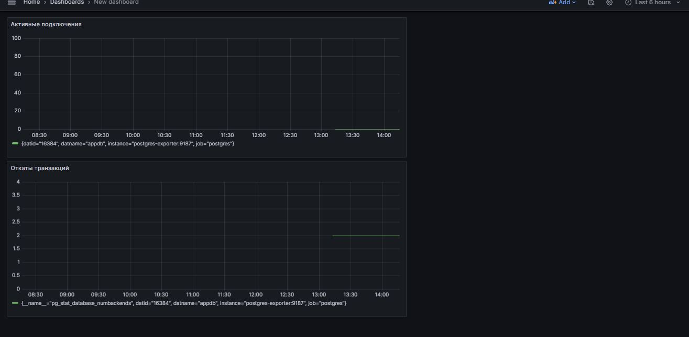

## Проблемы, с которыми я столкнулся (Troubleshooting)
1. **Команда `tail` в Windows:** Привычная Linux-команда `tail` для просмотра логов не работает в PowerShell. Пришлось использовать `docker compose logs --tail 30 primary` или `Select-Object -Last 30`.
2. **Ошибка `failed to read dockerfile`:** Windows по умолчанию скрывает расширения. Файл сохранился как `Dockerfile.txt`. Пришлось включить отображение расширений и переименовать файл.
3. **`Connection refused` при `pg_basebackup`:** Из-за того, что в `postgresql.conf` не был прописан `listen_addresses = '*'`, Postgres слушал только localhost. Исправлено добавлением параметра в конфиг.
4. **`pg_ctl: cannot be run as root`:** Утилиты Postgres запрещено запускать от имени root. Использован флаг `-u postgres` в `docker compose exec`.
5. **`ports are not available` (Grafana):** Порт 3000 был занят другой программой. Проброс порта в `docker-compose.yml` был изменен на `3001:3000`.

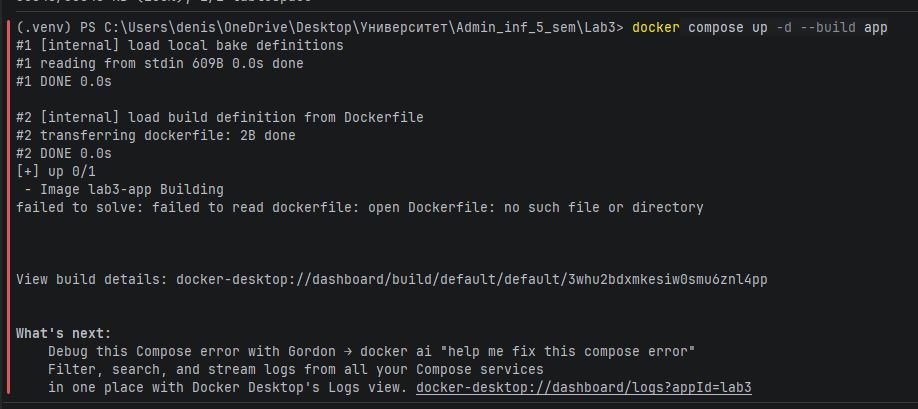
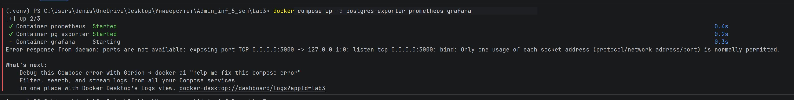

## Впечатления
Работа показалась довольно простой и логичной, так как за плечами есть два семестра работы с базами данных. Понимание того, как устроен WAL и как работают транзакции, сильно помогло при настройке streaming replication и написании SQL-запросов для мониторинга.